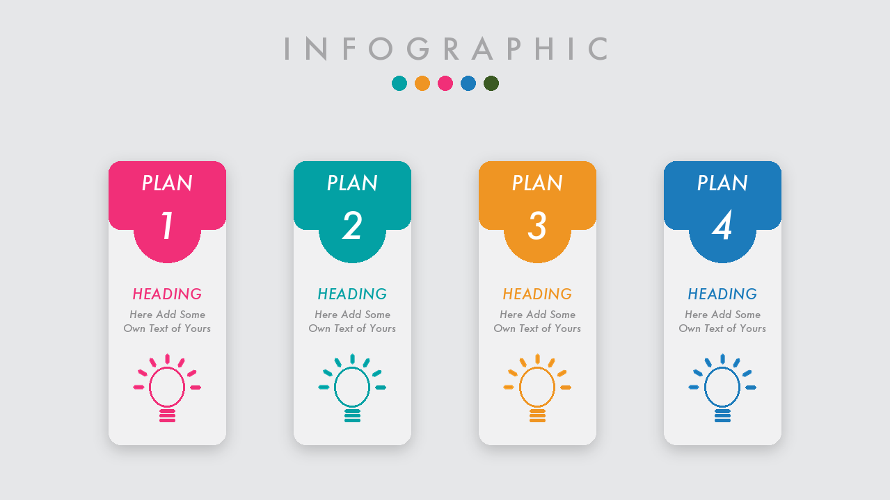
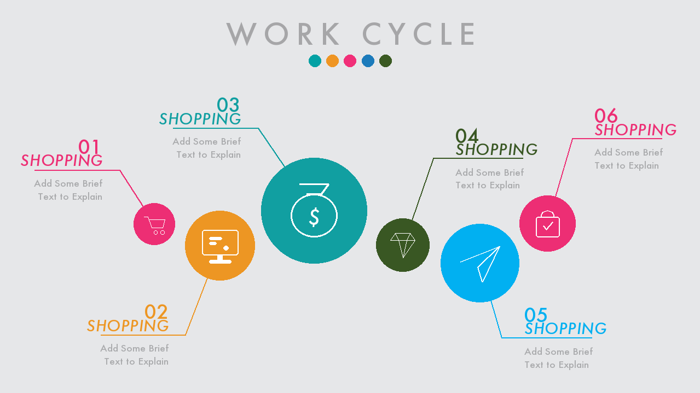
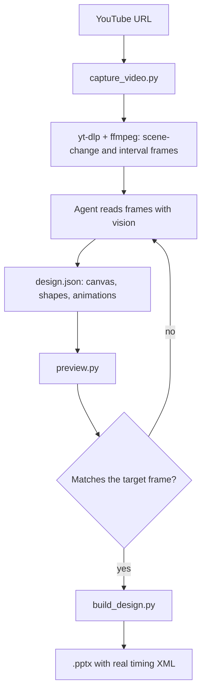

# Video-Tutorial-to-PPT

A [Cursor Agent Skill](https://cursor.com/docs) that turns a YouTube video into a real `.pptx`.

Most "video to slides" tools transcribe the narration and dump bullet points into a
template. That works for a lecture and fails completely for a design tutorial, where the
instructions live in the pixels: the host draws a rounded rectangle, picks a hex color,
opens the Animation Pane and sets a 0.50s Zoom. None of that is in the captions.

So this skill has two tracks. The **outline track** builds a bullet deck from a
transcript. The **design track** downloads the video, samples frames, reads them, and
rebuilds the slide that is being taught, animations included.

| | |
| --- | --- |
|  |  |

Both slides above were generated by this skill from design tutorials, then rendered to PNG
by the built-in preview. Each is a single `.pptx` slide with real entrance animations.

## How the design track works



The scripts only move pixels and emit XML. The interpretation — "that is a rounded
rectangle 1.75in wide with an `F12F78` cap" — is the agent's job, recorded in a
`design.json` spec.

### Measure, do not guess

A 1280x720 frame of a 16:9 slide is exactly **96 pixels per inch**, so frame coordinates
convert directly into slide inches. The agent samples the image with Pillow rather than
eyeballing it, scanning rows and columns for color runs to recover edges, diameters and
exact fills. On the work-cycle example every circle landed within 0.006in of the target
position and 0.03in of its diameter.

Two techniques worth knowing, both learned the hard way:

- Flood-filling by color merges a shape with any same-colored connector or label text.
  Eroding the mask by ~9px dissolves thin lines and leaves the solid shape behind.
- Measuring a circle by its longest horizontal run under-reports the diameter, because a
  white icon inside splits the run in two.

### Animations

`python-pptx` has no animation API at all, so `pptx_anim.py` emits raw DrawingML timing
trees. Effects are defined by their behaviour nodes, which is what actually plays; the
preset id only controls the label PowerPoint shows in the Animation Pane.

Entrance effects: `appear`, `fade`, `zoom`, `float_up`, `float_down`, `fly_in_*`,
`wipe_*`, `split`, `grow_turn`. Looping emphasis effects: `grow_shrink`, `spin`, `bob`,
`pulse_color`.

## Install

```bash
python3 -m pip install -r requirements.txt
brew install ffmpeg yt-dlp
```

Install `yt-dlp` from Homebrew rather than pip — the pip build tends to lag behind
YouTube's extractor changes and fails to download.

Then place this directory at `~/.cursor/skills/Video-Tutorial-to-PPT`.

## Use it directly

The scripts work standalone, without Cursor:

```bash
# 1. download and sample frames
python3 scripts/capture_video.py "https://www.youtube.com/watch?v=VIDEO_ID" --work work

# 2. write a design.json (see design-reference.md), then check the layout
python3 scripts/preview.py work/design.json work/preview.png

# 3. build the deck
python3 scripts/build_design.py work/design.json out.pptx
```

Rebuild a bundled example:

```bash
python3 scripts/build_design.py examples/work-cycle.design.json "Work Cycle.pptx"
```

## Scripts

| Script | Purpose |
| --- | --- |
| `capture_video.py` | Download the video and sample frames. `--at SECONDS` grabs one lossless PNG. |
| `fetch_transcript.py` | Captions when they exist; warns and exits 0 when they do not. |
| `build_design.py` | `design.json` to `.pptx`, animations included. |
| `preview.py` | `design.json` to PNG, for layout checking without PowerPoint. |
| `pptx_anim.py` | The timing-XML engine. |
| `build_pptx.py` | Outline-track bullet decks. |

Schemas: [design-reference.md](design-reference.md) for the design track,
[reference.md](reference.md) for the outline track.

## A note on source material

The design track rebuilds the *technique* a tutorial demonstrates, constructing every
shape from primitives in code. It does not extract media or XML from anyone's template,
and it is not a way to clone and redistribute someone else's deck. Icons in the examples
are simple original pictograms composed from ovals, rectangles and freeform outlines.
Only use it on material you have the right to reuse.

## Limits

- Frame reading recovers colors and geometry well; exact animation durations set through
  the Animation Pane are sometimes inferred rather than read.
- The PNG preview approximates fonts and shadows. It is a layout check, not a fidelity
  check.
- Animations only play in PowerPoint. Previews show the resting state.
- Prefer fonts that ship with Office so the deck travels between machines.

## License

MIT
